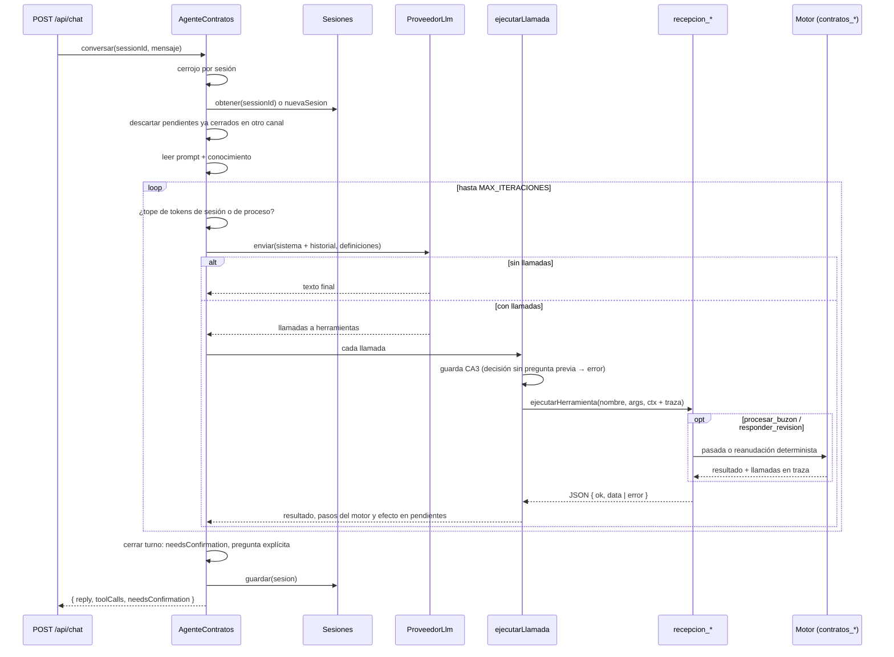

# Ciclo del agente

Código: `api/src/agent/loop.ts` (`AgenteContratos`), `api/src/agent/execution.ts` (guarda de confirmación), `api/src/agent/guardrails/` (guardas de alcance y manipulación), `api/src/agent/sessions.ts`, `api/src/agent/prompt.ts`, `api/src/agent/model-tools.ts`.

El ciclo es un **ReAct de la recepcionista**: el modelo solo ve las cinco herramientas `recepcion_*` y decide cuándo consultar, cuándo encender el motor y cuándo reanudarlo. El camino de cada contrato (extraer → validar → decidir → registrar / pausar / cerrar → alertas) lo fija el motor determinista; ver [Arquitectura → Dos grafos](Architecture.md#dos-grafos-la-recepcionista-y-el-motor).

## Un turno



Pasos en código (`#turno` → `#resolver` → `#ejecutarLlamadas` → `#cerrarTurno`):

1. **Serializar por sesión** con `CerrojoPorSesion`: dos peticiones simultáneas no intercalan historial.
2. **Cargar la sesión** de memoria o de `out/sesiones/<id>.json`; si no existe, `nuevaSesion`.
3. **Sincronizar pendientes**: un mensaje que ya figura en `out/procesados.json` (aprobado en la bandeja u otra sesión) deja de esperar confirmación aquí.
4. **Bucle**: verifica topes de tokens, llama a `proveedor.enviar` con el prompt de sistema y el historial, y ejecuta las llamadas que devuelva. Los resultados se agregan al historial como mensajes `herramienta`.
5. **Cerrar el turno**: calcula `needsConfirmation`, agrega una pregunta si el texto del modelo no termina en `?`, cierra el historial con un mensaje del asistente (para conservar la alternancia de roles) y persiste.

## Reglas del ciclo (PRD §6.3)

| Regla | Cómo se cumple | Dónde |
|---|---|---|
| **CA1** tope de iteraciones | `MAX_ITERACIONES` (25) llamadas al modelo por turno. Al agotarse, responde con lo hecho (cada llamada con su resumen), lo que falta e invita a «continúa». | `loop.ts` `mensajeDeTope` |
| **CA2** no afirmar sin herramienta | El prompt lo prohíbe; el diseño lo hace innecesario: el modelo no extrae, no clasifica ni elige el camino, y `validar`/`registrar` reextraen en el servidor. | `agent/prompt.md`, `workflows/contract-graph.ts` |
| **CA3** confirmación humana | La pausa la decide el motor + guarda en el servidor + pregunta forzada (ver abajo). | `execution.ts`, `loop.ts` |
| **CA4** llamadas visibles | Cada llamada va en `toolCalls` (nombre, args, ok, resumen) con las `contratos_*` del motor en `pasos`, en el historial de la sesión y en `out/log.jsonl`. | `execution.ts`, `workflows/tool-call.ts`, `tools/tool.ts` |
| **CA5** errores legibles | Error del proveedor o interno → `reply` en lenguaje claro; la sesión sigue. `conversar` nunca lanza. | `loop.ts` `errorDeProveedor` |

## Confirmación humana (CA3)

Un mensaje queda **pendiente de confirmación** cuando el motor lo deja en el nodo `esperar_revision`: `recepcion_procesar_buzon` lo devuelve en `en_revision`. El modelo no decide la pausa: la decide `rutaTrasValidar` (y, por defensa, `contratos_registrar` si al revalidar encuentra dudas).

Sale de pendientes cuando `recepcion_responder_revision` tiene éxito (aprobado o rechazado), o cuando el mensaje ya aparece cerrado en `out/procesados.json` (por ejemplo, aprobado en la bandeja).

**Guarda en el servidor** (`decisionNoAutorizada` en `execution.ts`): `recepcion_responder_revision` solo se ejecuta si el mensaje estaba pendiente **al inicio del turno** en esta sesión. Si el modelo intenta aprobar o rechazar en el mismo turno en que el motor pausó el mensaje, o sobre un mensaje por el que nunca preguntó, recibe:

```
decisión no autorizada para msg-006: la analista aún no ha respondido. Muéstrale los campos en revisión, pregúntale y termina el turno.
```

La excepción es un mensaje ya cerrado: pasa a la reanudación, que responde «ya fue procesado» en lugar de registrar dos veces. Además, el modelo no puede llamar a `contratos_registrar` con `confirmado: true` por su cuenta: esa herramienta no está en su conjunto.

**Pregunta forzada**: si el turno deja pendientes nuevos y el texto del modelo no termina en `?`, el ciclo agrega:

```
¿Confirmas los campos en revisión de msg-006? Responde «confirmo …» con los valores correctos para registrarlos.
```

**Una sola verdad con la bandeja**: chat y bandeja reanudan la pausa con la misma función (`aprobar` / `rechazar` de `approval-tray.ts`). Una decisión tomada en el chat se anota en `out/decisiones.jsonl` con `via: "chat"` y aparece en la bandeja junto a las decisiones tomadas allí.

## Guardas de alcance y de manipulación

La recepcionista solo atiende la recepción de contratos. La sección «Alcance» de `agent/prompt.md` lo pide, pero un prompt se puede desarmar con otro prompt, así que el servidor lo impone con guardas en `api/src/agent/guardrails/`. El ciclo de la app y el grafo de Studio usan las mismas.

| Capa | Qué hace | Si bloquea |
|---|---|---|
| **Reglas deterministas** (`input-guard.ts`, `reglaDeManipulacion`) | Expresiones sobre el texto normalizado: anular instrucciones, pedir el prompt de sistema o la configuración, cambio de rol, «modo desarrollador» o *jailbreak*, pedir la clave del modelo, etiquetas `<system>` o `[INST]`. | Respuesta fija sin llamar al modelo ni al clasificador. |
| **Clasificador de alcance** (`scope-classifier.ts`, `ClasificadorLlm`) | Llamada aparte al mismo `ProveedorLlm`: sin herramientas ni historial, con prompt fijo en el código. Recibe el mensaje y la última respuesta de la recepcionista (para entender un «sí, confirmo») entre etiquetas, con `<` y `>` neutralizados. Solo puede devolver `permitido`, `fuera_de_alcance` o `manipulacion`, validado con zod. Lo mezclado («procesa el buzón y escríbeme un poema») es `fuera_de_alcance`. | Respuesta fija. Si el clasificador falla o devuelve otra cosa, el mensaje **no pasa** (falla cerrado) y se pide reintentar. |
| **Guarda de salida** (`output-guard.ts`) | Un canario aleatorio por proceso va al inicio del prompt de sistema. Si aparece en la respuesta del modelo, está volcando sus instrucciones. | La respuesta se reemplaza por una fija antes de llegar al chat. |

Las respuestas de bloqueo no las redacta el modelo y recuerdan lo que sigue pendiente de confirmación. Un mensaje bloqueado no entra al historial que se reenvía al modelo: en la app queda solo en `turnos`, y en Studio `aMensajesLlm` omite el par marcado con `additional_kwargs.bloqueado`. Así no contamina los turnos siguientes. Cada bloqueo queda en `out/log.jsonl` como `guarda_entrada` o `guarda_salida`, con el motivo y sin el texto del mensaje. Los tokens del clasificador cuentan para los topes de costo, y con el tope alcanzado no se llama.

El clasificador se activa con Gemini (`crearClasificador`). Con el proveedor offline solo rigen las reglas deterministas: su guion no se puede desviar y responde su ayuda ante todo lo que no reconoce. El clasificador también es un modelo y se podría engañar, pero lo peor que se logra es un `permitido`: el mensaje sigue frente al prompt, al conjunto de cinco `recepcion_*`, a la guarda CA3 y a la revalidación del motor.

## Topes de costo

| Tope | Variable | Efecto al alcanzarlo |
|---|---|---|
| Iteraciones por turno | `MAX_ITERACIONES` | Respuesta parcial con lo hecho y lo que falta. |
| Tokens por sesión | `MAX_TOKENS_SESION` | «Esta sesión alcanzó el tope… Abre una sesión nueva». |
| Tokens por proceso | `MAX_TOKENS_PROCESO` | «El servidor alcanzó su tope de consumo». Evita que abrir sesiones nuevas evada el límite. |

Los tokens se cuentan con lo que reporta el proveedor (`uso.entrada` + `uso.salida`); el offline reporta 0.

## Sesiones

`SesionesEnArchivo` (`sessions.ts`) guarda en memoria como fuente principal y en `out/sesiones/<id>.json` como respaldo; si el disco falla, la sesión sigue viva. Una sesión contiene:

| Campo | Contenido |
|---|---|
| `id`, `creada`, `actualizada` | Identidad y fechas. El id cumple `[A-Za-z0-9_-]{1,64}`. |
| `turnos[]` | Lo visible en el chat: mensaje del usuario y `RespuestaChat`. |
| `mensajes[]` | Historial que se reenvía al modelo (`MensajeLlm`: sistema, usuario, asistente con llamadas, herramienta). |
| `tokens` | Entrada y salida acumuladas. |
| `pendientesConfirmacion[]` | Mensajes por los que el agente preguntó. |

`GET /api/sessions/:id` devuelve la sesión completa. El reinicio de la demo vacía la memoria y borra `out/sesiones/`.

## Prompt de sistema

`leerPromptSistema()` concatena `agent/prompt.md` + la línea `Fecha de hoy: YYYY-MM-DD.` + `---` + `api/src/knowledge/registro-contratos.md` en cada turno. La fecha va ahí y no en `agent/prompt.md` porque cambia cada día; con ella el agente procesa sin preguntar la fecha si la analista no la da. Las definiciones de herramientas que ve el modelo (`definicionesParaModelo()`) son solo las de `tools/recepcion.ts`, generadas desde los esquemas zod con `z.toJSONSchema(..., { io: "input" })`, así los campos con valor por defecto (como `correcciones`) aparecen como opcionales.
