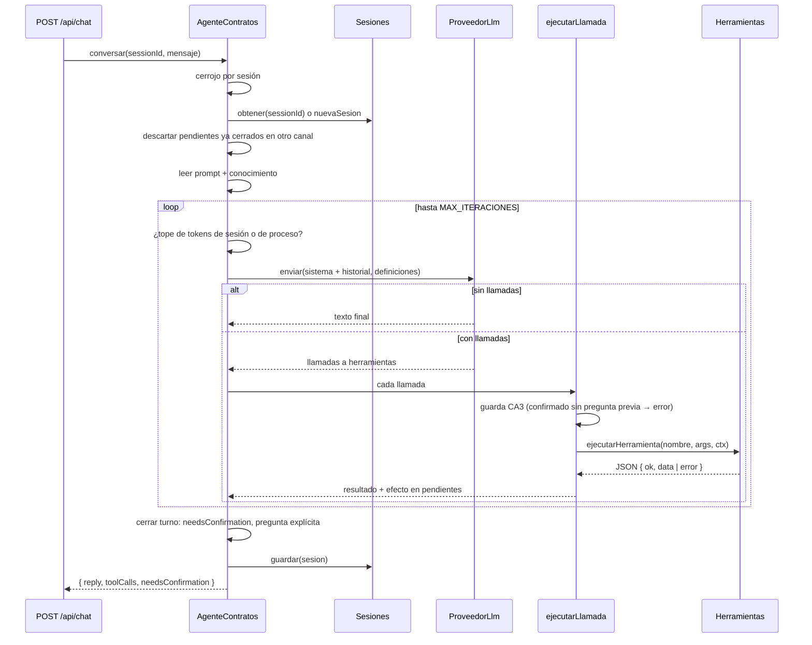

# Ciclo del agente

Código: `api/src/agent/loop.ts` (`AgenteContratos`), `api/src/agent/execution.ts` (guarda de confirmación), `api/src/agent/sessions.ts`, `api/src/agent/prompt.ts`, `api/src/agent/model-tools.ts`.

## Un turno



Pasos en código (`#turno` → `#resolver` → `#ejecutarLlamadas` → `#cerrarTurno`):

1. **Serializar por sesión** con `CerrojoPorSesion`: dos peticiones simultáneas no intercalan historial.
2. **Cargar la sesión** de memoria o de `out/sesiones/<id>.json`; si no existe, `nuevaSesion`.
3. **Sincronizar pendientes**: un mensaje que ya figura en `out/procesados.json` (aprobado en la bandeja u otra sesión) deja de esperar confirmación aquí.
4. **Bucle**: verifica topes de tokens, llama a `proveedor.enviar` con el prompt de sistema y el historial, y ejecuta las llamadas que devuelva. Los resultados se agregan al historial como mensajes `herramienta`.
5. **Cerrar el turno**: calcula `needsConfirmation`, agrega una pregunta si el texto del modelo no termina en `?`, cierra el historial con un mensaje del asistente (para conservar la alternancia de roles) y persiste.

## Reglas del ciclo (PRD §6.3)

| Regla | Cómo se cumple | Dónde |
|---|---|---|
| **CA1** tope de iteraciones | `MAX_ITERACIONES` (25) llamadas al modelo por turno. Al agotarse, responde con lo hecho (cada llamada con su resumen), lo que falta e invita a «continúa». | `loop.ts` `mensajeDeTope` |
| **CA2** no afirmar sin herramienta | El prompt lo prohíbe; el diseño lo hace innecesario: el modelo no extrae ni clasifica, y `validar`/`registrar` reextraen en el servidor. | `agent/prompt.md`, `use-cases/validate.ts` |
| **CA3** confirmación humana | Detección determinista por resultados de herramientas + guarda en el servidor + pregunta forzada (ver abajo). | `execution.ts`, `loop.ts` |
| **CA4** llamadas visibles | Cada llamada va en `toolCalls` (nombre, args, ok, resumen), en el historial de la sesión y en `out/log.jsonl`. | `execution.ts`, `tools/tool.ts` |
| **CA5** errores legibles | Error del proveedor o interno → `reply` en lenguaje claro; la sesión sigue. `conversar` nunca lanza. | `loop.ts` `errorDeProveedor` |

## Confirmación humana (CA3)

Un mensaje queda **pendiente de confirmación** cuando:

- `contratos_validar` devuelve `nuevo`/`actualizacion` con `requiere_revision` no vacío, o
- `contratos_registrar` falla con un error que empieza por `requiere revisión` (`PREFIJO_REQUIERE_REVISION`).

Sale de pendientes cuando `contratos_registrar` tiene éxito.

**Guarda en el servidor** (`confirmacionNoAutorizada` en `execution.ts`): `contratos_registrar` con `confirmado: true` solo se ejecuta si el mensaje estaba pendiente **al inicio del turno**. Si el modelo intenta autoconfirmar en el mismo turno en que detectó la duda, recibe:

```
confirmación no autorizada para msg-006: el usuario aún no ha confirmado. Muéstrale los campos en revisión, pregúntale y termina el turno.
```

La excepción es un mensaje ya cerrado: pasa a `registrar`, que responde «ya fue procesado» en lugar de registrar dos veces.

**Pregunta forzada**: si el turno deja pendientes nuevos y el texto del modelo no termina en `?`, el ciclo agrega:

```
¿Confirmas los campos en revisión de msg-006? Responde «confirmo …» con los valores correctos para registrarlos.
```

**Una sola verdad con la bandeja**: una confirmación aceptada en el chat se anota en `out/decisiones.jsonl` con `via: "chat"` y aparece en la bandeja junto a las decisiones tomadas allí.

## Topes de costo

| Tope | Variable | Efecto al alcanzarlo |
|---|---|---|
| Iteraciones por turno | `MAX_ITERACIONES` | Respuesta parcial con lo hecho y lo que falta. |
| Tokens por sesión | `MAX_TOKENS_SESION` | «Esta sesión alcanzó el tope… Abre una sesión nueva». |
| Tokens por proceso | `MAX_TOKENS_PROCESO` | «El servidor alcanzó su tope de consumo». Evita que abrir sesiones nuevas evada el límite. |

Los tokens se cuentan con lo que reporta el proveedor (`uso.entrada` + `uso.salida`); el offline reporta 0.

## Sesiones

`SesionesEnArchivo` (`sessions.ts`) guarda en memoria como fuente principal y en `out/sesiones/<id>.json` como respaldo; si el disco falla, la sesión sigue viva. Una sesión contiene:

| Campo | Contenido |
|---|---|
| `id`, `creada`, `actualizada` | Identidad y fechas. El id cumple `[A-Za-z0-9_-]{1,64}`. |
| `turnos[]` | Lo visible en el chat: mensaje del usuario y `RespuestaChat`. |
| `mensajes[]` | Historial que se reenvía al modelo (`MensajeLlm`: sistema, usuario, asistente con llamadas, herramienta). |
| `tokens` | Entrada y salida acumuladas. |
| `pendientesConfirmacion[]` | Mensajes por los que el agente preguntó. |

`GET /api/sessions/:id` devuelve la sesión completa. El reinicio de la demo vacía la memoria y borra `out/sesiones/`.

## Prompt de sistema

`leerPromptSistema()` concatena `agent/prompt.md` + `---` + `api/src/knowledge/registro-contratos.md` en cada turno. Las definiciones de herramientas que ve el modelo (`definicionesParaModelo()`) se generan desde los esquemas zod con `z.toJSONSchema(..., { io: "input" })`, así los campos con valor por defecto (como `confirmado`) aparecen como opcionales.
