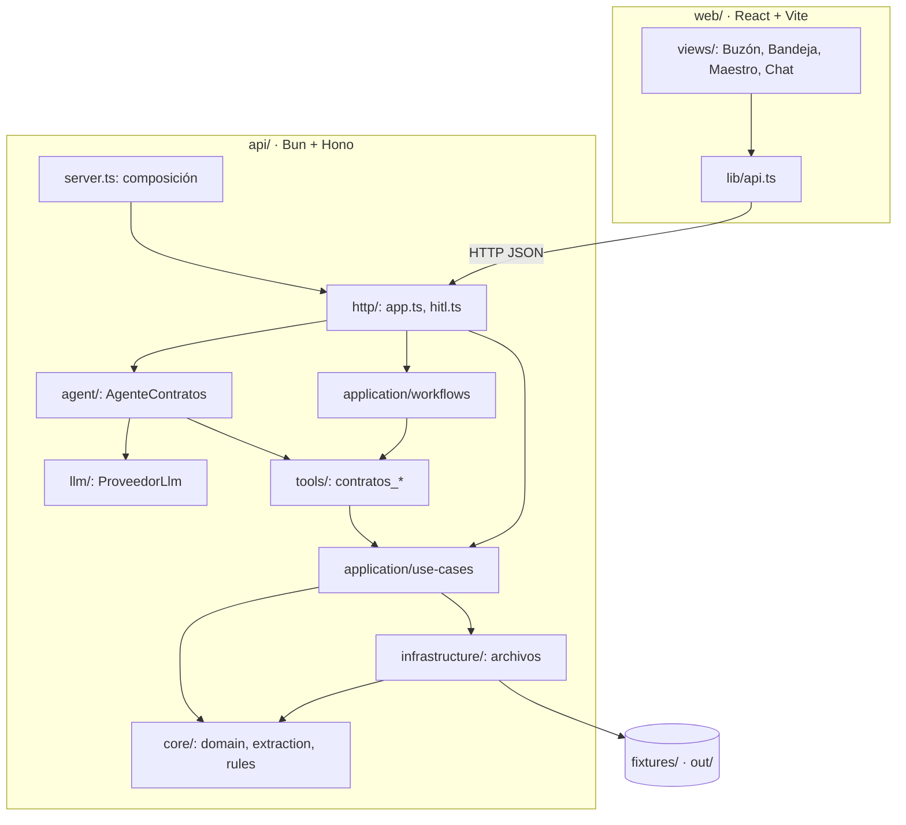

# Arquitectura

## Vista general



## Capas

| Capa | Carpeta | Responsabilidad | Puede depender de |
|---|---|---|---|
| Núcleo | `api/src/core/` | Tipos y esquemas del dominio, extracción determinista y reglas RN1–RN5. Funciones puras, sin E/S. | nada del proyecto |
| Infraestructura | `api/src/infrastructure/` | Leer y escribir `fixtures/` y `out/`: CSV del maestro, JSON/JSONL, rutas seguras, cerrojo de `out/`. | `core` |
| Aplicación | `api/src/application/use-cases/` | Un caso de uso por historia: leer buzón, validar, registrar, alertas, vistas, reinicio. | `core`, `infrastructure` |
| Herramientas | `api/src/tools/` | Contrato del PRD 6.2: `{ description, args, execute }`, validación zod, log, nunca lanzan. | `application`, `core`, `infrastructure` |
| Orquestación | `api/src/application/workflows/` | Secuencias sobre las herramientas: pasada del buzón (`demo.ts`) y acciones de la bandeja. | `tools` y lo anterior |
| Agente | `api/src/agent/` | Ciclo prompt → modelo → herramientas, guarda de confirmación, sesiones. | `llm`, `tools`, `application` |
| LLM | `api/src/llm/` | Interfaz `ProveedorLlm` y sus implementaciones. | `core`, `config` (y tipos de `application` para el guion offline) |
| HTTP | `api/src/http/` | Rutas Hono delgadas, validación de cuerpos, errores tipados. | todo lo anterior |
| Arranque | `api/src/server.ts`, `api/src/config.ts` | Leer entorno, componer dependencias, servir API + front. | todo |

**Regla**: las dependencias apuntan hacia adentro. Un archivo de `core/` nunca importa de otra carpeta; uno de `infrastructure/` solo importa de `core/`.

### Acoplamientos conocidos

- `api/src/http/types.ts` define los tipos que comparten backend y front (`RespuestaChat`, `EstadoMensaje`, `DetalleMensaje`…). Algunos casos de uso y el agente los importan para devolver exactamente lo que la API expone. Son solo tipos (`import type`), no lógica.
- `workflows/` llama a las herramientas y las herramientas llaman a `use-cases/`: por eso orquestación y casos de uso están separados en dos subcarpetas, para que la dirección sea siempre `workflows → tools → use-cases`.

## Comportamiento, conocimiento y ejecución

Separación que evalúa el PRD (§6.5):

| Pieza | Dónde | Cómo se usa |
|---|---|---|
| Comportamiento | `agent/prompt.md` | System prompt: qué hace el agente, qué no puede afirmar, cuándo pregunta, formato de respuesta. |
| Conocimiento | `api/src/knowledge/registro-contratos.md` | Reglas, esquema, umbral, alertas, supuestos y gobierno. Se anexa al prompt. |
| Ejecución | `api/src/tools/contratos.ts` y capas inferiores | Única fuente de valores. |
| Parámetros | `api/src/core/domain/parameters.ts` | Umbral 0.8, similitud 0.9, fecha de corte, ventana de 60 días. |

`api/src/agent/prompt.ts` lee prompt + conocimiento **en cada turno**: cambiar el proceso no requiere reiniciar el servidor.

## Composición (inversión de dependencias)

`api/src/server.ts` es el único lugar que conoce las implementaciones concretas:

```ts
const proveedor = crearProveedor(config);              // api/src/llm/factory.ts
const sesiones = new SesionesEnArchivo(config.directorio);
const agente = new AgenteContratos({ proveedor, sesiones, directorio, limites });
const app = crearApp({ agente, sesiones, directorio, webDist, origenesCors });
Bun.serve({ port, fetch: app.fetch, idleTimeout: 255 });
```

- El ciclo del agente solo conoce `ProveedorLlm` y `AlmacenSesiones` (interfaces).
- La API recibe `Pick<AgenteContratos, "conversar" | "proveedor">`, así los tests pueden inyectar dobles.
- Todas las rutas de archivos parten de `directorio` (raíz del proyecto), que en los tests es una carpeta temporal.

## Concurrencia

| Mecanismo | Archivo | Qué garantiza |
|---|---|---|
| `CerrojoPorSesion` | `api/src/agent/sessions.ts` | Los turnos de una misma sesión se ejecutan en serie: dos peticiones simultáneas no intercalan historial. La bandeja usa otro cerrojo para aplicar sus acciones de a una. |
| `AccesoOut` | `api/src/infrastructure/out-lock.ts` | Cerrojo lector/escritor sobre `out/`: turnos y bandeja lo comparten; el reinicio de la demo lo toma en exclusiva, espera a los que están en curso y retiene los nuevos. |
| Escritura atómica | `api/src/infrastructure/files.ts` | El maestro y los JSON se escriben en un temporal y se renombran: nunca quedan a medio escribir. |

Hay un solo proceso: no hay bloqueo entre procesos (ver riesgos en `SOLUCION.md` §11).

## Manejo de errores

| Capa | Estrategia |
|---|---|
| `core` | Devuelve `Resultado<T>`. Los errores de datos del documento (`ErrorExtraccion`) se convierten en `{ ok: false }` en el borde del extractor. |
| Herramientas | `definirHerramienta` valida con zod, ejecuta dentro de `try/catch` y devuelve `{ ok: false, error }` legible. **Nunca lanza.** Un fallo al escribir el log va a stderr sin tumbar la herramienta. |
| `ProveedorLlm` | Red, HTTP, timeout (`AbortController`) o respuesta bloqueada vuelven como `{ ok: false, error }`. |
| Ciclo del agente | Cualquier fallo se convierte en `reply` legible; la sesión sigue utilizable (CA5). |
| API | Cuerpo inválido → `400 peticion_invalida`; códigos de negocio → `404`/`409`/`422`; excepción no prevista → `500 error_interno` sin detalles internos (el detalle va al log del servidor). |
| Front | `lib/api.ts` convierte cualquier fallo en `ErrorDeApi` con mensaje en español y el `codigo` del backend. |

Logs del servidor con prefijo por área: `[server]`, `[agente]`, `[api]`, `[log]`, `[sesiones]`, `[decisiones]`, `[demo]`.

## Principios aplicados

- **Responsabilidad única**: un archivo por campo extraído, por regla, por caso de uso y por recurso de almacenamiento.
- **Abierto/cerrado**: un proveedor LLM nuevo es otra clase que implementa `ProveedorLlm`; una herramienta nueva es otro `definirHerramienta`.
- **Inversión de dependencias**: el ciclo depende de interfaces; la composición vive en `server.ts` y `llm/factory.ts`.
- **DRY**: chat, bandeja, `demo.ts` y tests usan las mismas herramientas; validación, log y "nunca lanzar" viven en un solo lugar (`tools/tool.ts`).
- **KISS / YAGNI**: sin base de datos, sin SDK de LLM, sin framework de agentes; archivos en `out/` como pide el PRD.
