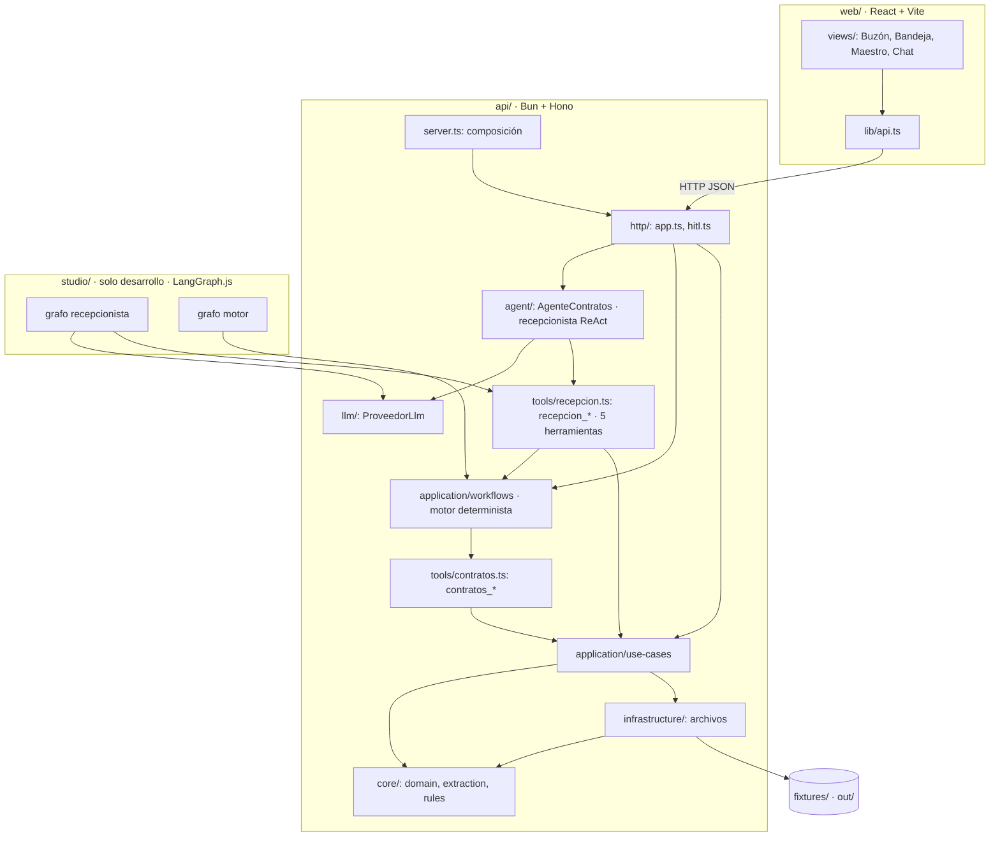
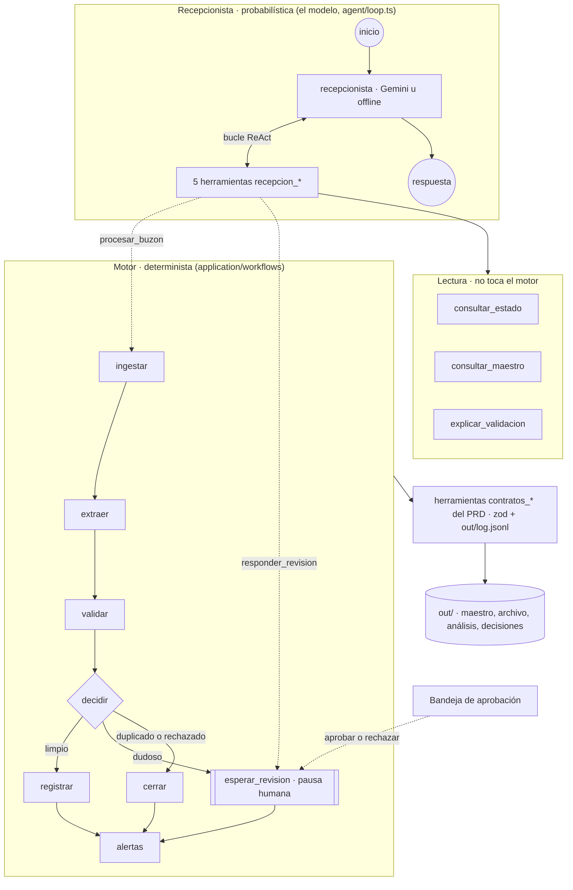

# Arquitectura

## Vista general



## Dos grafos: la recepcionista y el motor

El agente está partido en dos para que el modelo converse pero nunca decida el camino de un contrato:



Cada nodo del motor llama a una herramienta del PRD: `ingestar` → `contratos_leer_buzon`, `extraer` → `contratos_extraer`, `validar` → `contratos_validar`, `registrar` → `contratos_registrar`, `alertas` → `contratos_alertas`. Reanudar la pausa es **aprobar** (aplicar correcciones y `contratos_registrar` con `confirmado: true`) o **rechazar** (cerrar sin tocar el maestro), desde el chat, la bandeja o Studio, siempre con la misma función (`reanudarRevision`).

| Herramienta de la recepcionista | Tipo | Qué hace por debajo |
|---|---|---|
| `recepcion_consultar_estado` | lectura | `listarBuzon`: estado de cada mensaje derivado de `out/`. |
| `recepcion_consultar_maestro` | lectura | `consultarMaestro`: filas del maestro por id, cliente o NIT. |
| `recepcion_explicar_validacion` | lectura | `explicarMensaje`: extracción con confianza, validación, decisión y línea de tiempo. |
| `recepcion_procesar_buzon` | dispara el motor | `ejecutarPasada`: ingestar → grafo por mensaje → alertas. |
| `recepcion_responder_revision` | reanuda el motor | `reanudarRevision`: aprobar (registrar con `confirmado: true`) o rechazar, y alertas. |

El modelo **no ve** las `contratos_*`: si las nombra, recibe `herramienta desconocida`. La arista de `decidir` es una función pura (`rutaTrasValidar` en `contract-graph.ts`) y cada mensaje devuelve su `recorrido` de nodos y su `desenlace`. El grafo de cada mensaje está definido una sola vez, como tabla de nodos (`NODOS`) y su topología (`ARISTAS`).

### Casos de uso

| Pide la analista | Qué hace la recepcionista | ¿Toca el motor? |
|---|---|---|
| «¿Cuándo vence CT-2026-009?» | Una llamada a `recepcion_consultar_maestro` y responde con la fila. | No |
| «¿Por qué msg-006 no se registró?» | Una llamada a `recepcion_explicar_validacion`. | No |
| «Procesa el buzón con fecha de hoy 2026-09-03» | Una llamada a `recepcion_procesar_buzon`; el motor ejecuta 17 pasos `contratos_*`, pausa msg-006 y la recepcionista termina con una pregunta. | Sí: lo enciende |
| «Confirmo el valor 0 y la fecha fin 2027-08-31» | Una llamada a `recepcion_responder_revision` con esas correcciones; el motor registra y regenera alertas. | Sí: lo reanuda |

### Dos formas de recorrer los mismos grafos

| | App (`bun run dev`) | LangGraph Studio (`bun run studio`) |
|---|---|---|
| Recepcionista | Ciclo propio en `api/src/agent/loop.ts` | `studio/src/receptionist-graph.ts` |
| Motor | `ejecutarGrafoMensaje` recorre `NODOS` | `studio/src/engine-graph.ts` recorre los mismos `NODOS` con LangGraph |
| Pausa humana | Termina el turno; se reanuda en el siguiente o en la bandeja | `interrupt()` en `revision_humana` |
| Comparten | Prompt, conocimiento, `ProveedorLlm`, las cinco `recepcion_*`, la guarda CA3 (`execution.ts`), el cierre del turno (`turn.ts`) y `out/` | |

Studio es solo de desarrollo: la app no depende de LangGraph. Ver [LangGraph Studio](Studio.md).

## Capas

| Capa | Carpeta | Responsabilidad | Puede depender de |
|---|---|---|---|
| Núcleo | `api/src/core/` | Tipos y esquemas del dominio, extracción determinista y reglas RN1–RN5. Funciones puras, sin E/S. | nada del proyecto |
| Infraestructura | `api/src/infrastructure/` | Leer y escribir `fixtures/` y `out/`: CSV del maestro, JSON/JSONL, rutas seguras, cerrojo de `out/`. | `core` |
| Aplicación | `api/src/application/use-cases/` | Un caso de uso por historia: leer buzón, validar, registrar, alertas, vistas, reinicio. | `core`, `infrastructure` |
| Herramientas del proceso | `api/src/tools/contratos.ts` | Contrato del PRD 6.2: `{ description, args, execute }`, validación zod, log, nunca lanzan. Las llama el motor. | `application/use-cases`, `core`, `infrastructure` |
| Motor determinista | `api/src/application/workflows/` | Grafo por mensaje (`contract-graph.ts`), pasada del buzón (`process-mailbox.ts`) y reanudación tras la pausa humana (`approval-tray.ts`). | `tools/contratos.ts` y lo anterior |
| Herramientas del chat | `api/src/tools/recepcion.ts` | Las cinco `recepcion_*` que ve el modelo: leen o encienden el motor; sin reglas de negocio. | `workflows`, `use-cases` |
| Agente | `api/src/agent/` | Ciclo ReAct de la recepcionista, guarda de confirmación, sesiones. | `llm`, `tools/recepcion.ts` |
| LLM | `api/src/llm/` | Interfaz `ProveedorLlm` y sus implementaciones. | `core`, `config` (y tipos de `application` para el guion offline) |
| HTTP | `api/src/http/` | Rutas Hono delgadas, validación de cuerpos, errores tipados. | todo lo anterior |
| Arranque | `api/src/server.ts`, `api/src/config.ts` | Leer entorno, componer dependencias, servir API + front. | todo |

**Regla**: las dependencias apuntan hacia adentro. Un archivo de `core/` nunca importa de otra carpeta; uno de `infrastructure/` solo importa de `core/`.

### Acoplamientos conocidos

- `api/src/http/types.ts` define los tipos que comparten backend y front (`RespuestaChat`, `EstadoMensaje`, `DetalleMensaje`…). Algunos casos de uso y el agente los importan para devolver exactamente lo que la API expone. Son solo tipos (`import type`), no lógica.
- `workflows/` llama a las herramientas del proceso y estas llaman a `use-cases/`: por eso motor y casos de uso están en dos subcarpetas. La dirección es siempre `recepcion_* → workflows → contratos_* → use-cases`, sin ciclos.
- `ContextoHerramienta.traza` lleva las llamadas `contratos_*` que hizo el motor bajo una herramienta del chat; el ciclo las adjunta como `pasos` de esa llamada visible.

## Comportamiento, conocimiento y ejecución

Separación que evalúa el PRD (§6.5):

| Pieza | Dónde | Cómo se usa |
|---|---|---|
| Comportamiento | `agent/prompt.md` | System prompt: qué hace el agente, qué no puede afirmar, cuándo pregunta, formato de respuesta. |
| Conocimiento | `api/src/knowledge/registro-contratos.md` | Reglas, esquema, umbral, alertas, supuestos y gobierno. Se anexa al prompt. |
| Ejecución | `api/src/tools/recepcion.ts` → motor (`application/workflows/`) → `api/src/tools/contratos.ts` y capas inferiores | Única fuente de valores y único dueño del orden del proceso. |
| Parámetros | `api/src/core/domain/parameters.ts` | Umbral 0.8, similitud 0.9, fecha de corte, ventana de 60 días. |

`api/src/agent/prompt.ts` lee prompt + conocimiento **en cada turno**: cambiar el proceso no requiere reiniciar el servidor.

## Composición (inversión de dependencias)

`api/src/server.ts` es el único lugar que conoce las implementaciones concretas:

```ts
const proveedor = crearProveedor(config);              // api/src/llm/factory.ts
const sesiones = new SesionesEnArchivo(config.directorio);
const agente = new AgenteContratos({ proveedor, sesiones, directorio, limites });
const app = crearApp({ agente, sesiones, directorio, webDist, origenesCors });
Bun.serve({ port, fetch: app.fetch, idleTimeout: 255 });
```

- El ciclo del agente solo conoce `ProveedorLlm` y `AlmacenSesiones` (interfaces).
- La API recibe `Pick<AgenteContratos, "conversar" | "proveedor">`, así los tests pueden inyectar dobles.
- Todas las rutas de archivos parten de `directorio` (raíz del proyecto), que en los tests es una carpeta temporal.

## Concurrencia

| Mecanismo | Archivo | Qué garantiza |
|---|---|---|
| `CerrojoPorSesion` | `api/src/agent/sessions.ts` | Los turnos de una misma sesión se ejecutan en serie: dos peticiones simultáneas no intercalan historial. La bandeja usa otro cerrojo para aplicar sus acciones de a una. |
| `AccesoOut` | `api/src/infrastructure/out-lock.ts` | Cerrojo lector/escritor sobre `out/`: turnos y bandeja lo comparten; el reinicio de la demo lo toma en exclusiva, espera a los que están en curso y retiene los nuevos. |
| Escritura atómica | `api/src/infrastructure/files.ts` | El maestro y los JSON se escriben en un temporal y se renombran: nunca quedan a medio escribir. |

Hay un solo proceso: no hay bloqueo entre procesos (ver riesgos en `SOLUCION.md` §11).

## Manejo de errores

| Capa | Estrategia |
|---|---|
| `core` | Devuelve `Resultado<T>`. Los errores de datos del documento (`ErrorExtraccion`) se convierten en `{ ok: false }` en el borde del extractor. |
| Herramientas | `definirHerramienta` valida con zod, ejecuta dentro de `try/catch` y devuelve `{ ok: false, error }` legible. **Nunca lanza.** Un fallo al escribir el log va a stderr sin tumbar la herramienta. |
| `ProveedorLlm` | Red, HTTP, timeout (`AbortController`) o respuesta bloqueada vuelven como `{ ok: false, error }`. |
| Ciclo del agente | Cualquier fallo se convierte en `reply` legible; la sesión sigue utilizable (CA5). |
| API | Cuerpo inválido → `400 peticion_invalida`; códigos de negocio → `404`/`409`/`422`; excepción no prevista → `500 error_interno` sin detalles internos (el detalle va al log del servidor). |
| Front | `lib/api.ts` convierte cualquier fallo en `ErrorDeApi` con mensaje en español y el `codigo` del backend. |

Logs del servidor con prefijo por área: `[server]`, `[agente]`, `[api]`, `[log]`, `[sesiones]`, `[decisiones]`, `[demo]`.

## Principios aplicados

- **Responsabilidad única**: un archivo por campo extraído, por regla, por caso de uso y por recurso de almacenamiento.
- **Abierto/cerrado**: un proveedor LLM nuevo es otra clase que implementa `ProveedorLlm`; una herramienta nueva es otro `definirHerramienta`.
- **Inversión de dependencias**: el ciclo depende de interfaces; la composición vive en `server.ts` y `llm/factory.ts`.
- **DRY**: chat, bandeja, `demo.ts` y tests usan el mismo motor y las mismas herramientas; validación, log y "nunca lanzar" viven en un solo lugar (`tools/tool.ts`).
- **Segregación de interfaces**: el modelo ve cinco herramientas con una responsabilidad cada una, no el proceso completo; menos opciones, menos alucinación y ningún atajo para saltarse una validación.
- **KISS / YAGNI**: sin base de datos, sin SDK de LLM, sin framework de agentes ni motor de grafos genérico (el grafo es una función tipada de seis nodos); archivos en `out/` como pide el PRD.
