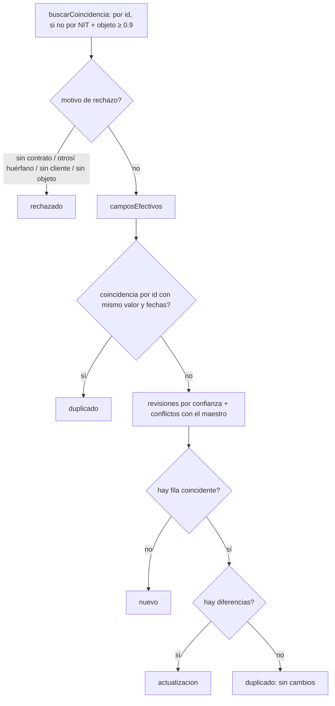
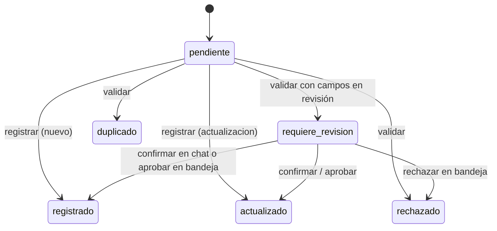

# Reglas de negocio

Código: `api/src/core/rules/` (puro) y `api/src/application/use-cases/validate.ts` / `register.ts` (lo aplican con E/S). Parámetros en `api/src/core/domain/parameters.ts`. Texto para el agente en `api/src/knowledge/registro-contratos.md`.

## RN1–RN7

| # | Regla | Dónde |
|---|---|---|
| RN1 | **Duplicado**: mismo `id_contrato` y mismos `valor`, `fecha_inicio`, `fecha_fin`. No se escribe. Un otrosí ya aplicado también es duplicado. | `classify.ts` `esDuplicado` |
| RN2 | **Actualización**: mismo `id_contrato` (o mismo NIT + `objeto` con similitud ≥ 0.9) y algún campo distinto, o un otrosí. Se actualiza la fila y se registra en `historial.jsonl`. | `matching.ts`, `classify.ts` |
| RN3 | **Nuevo**: sin coincidencia. Se inserta. | `classify.ts` |
| RN4 | **Rechazado**: sin adjunto de contrato, otrosí de un contrato ausente, o sin contraparte ni objeto identificables. | `classify.ts` `motivoDeRechazo` |
| RN5 | Confianza < 0.8 o conflicto con el maestro → `requiere_revision`. `registrar` sin `confirmado` lo rechaza. | `classify.ts`, `register.ts` |
| RN6 | El fixture del maestro es de solo lectura; la primera ejecución lo copia a `out/sharepoint/`. | `infrastructure/master-store.ts` `asegurarMaestro` |
| RN7 | Toda ejecución de herramienta deja `{ ts, herramienta, mensaje_id, ok, resumen }` en `out/log.jsonl`. | `tools/tool.ts` |

## Clasificación

`clasificar()` es una función pura: recibe el contrato propuesto, el extraído en el servidor, el maestro y los adjuntos.

Duplicado (RN1) se evalúa antes que actualización.

### Qué entra en `requiere_revision`

- Campos con confianza < 0.8 (salvo los heredados del maestro).
- Campos que el llamador cambió respecto al documento (confianza 0, motivo «difiere de lo extraído»).
- Conflictos con el maestro:
  - NIT distinto para el mismo id.
  - Mismo NIT + objeto ≥ 0.9 con otro número de contrato.
  - NIT conocido con otra razón social.
  - `fecha_fin` anterior a `fecha_inicio`.

## Campos efectivos

`camposEfectivos()` (`fields.ts`) decide el valor y la confianza de cada campo **sin confiar en el llamador**:

| Origen | Cuándo | Confianza |
|---|---|---|
| `documento` | El valor propuesto coincide con el extraído en el servidor. | La de la extracción. |
| `usuario` | El valor propuesto difiere del documento. | 0 → solo pasa con `confirmado: true`. |
| `maestro` | Otrosí: el campo no viene en el documento y existe la fila. | 1 (heredado). |

Las correcciones de la bandeja llegan con confianza 1 y evidencia `corregido por <aprobador>`, pero igual pasan por `registrar` con `confirmado: true`, que revalida todo.

## Construcción de la fila

`construirFila()` (`master-row.ts`):

| Columna | Regla |
|---|---|
| `id_contrato` | El del documento o `AUTO-<año_inicio>-<secuencia de 3 dígitos>`. |
| `tipo_poliza` | Vacío si no requiere póliza. |
| `estado_poliza` | Sin póliza → `no_aplica`. Nuevo con póliza → `pendiente`. Otrosí que amplía el plazo de un contrato con póliza → `pendiente`. Si no, conserva el estado existente. |
| `comercial` | El existente o el nombre resuelto desde `comerciales.json`; remitente desconocido → su correo (y un aviso). |
| `ruta_sharepoint` | `Contratos/<año_inicio>/<slug-cliente>/<id>.<ext>`. Un otrosí se archiva como `<id>-otrosi-<n>.<ext>` y la fila conserva la ruta del original. |
| `fecha_registro`, `fuente` | En una actualización se conservan los originales; en un nuevo, la fecha del sistema (o `ctx.hoy`) y `buzon`. |

La fila se valida con `FilaMaestroSchema` antes de escribir; si falta algo, `registrar` falla con `datos incompletos o inválidos para registrar: …`.

## Estados de un mensaje

Derivados solo de `out/` (`message-status.ts`), iguales para el chat, el buzón y la bandeja:

- `requiere_revision` = último análisis en `analisis.json` es `nuevo`/`actualizacion` con revisiones y el mensaje no está en `procesados.json`.
- `registrado`, `actualizado`, `duplicado`, `rechazado` son **terminales**: están en `procesados.json` y un mensaje cerrado no se reevalúa (validarlo contra el maestro que él mismo actualizó daría duplicado).

## Alertas (HU-5)

`contratos_alertas` (`use-cases/alerts.ts`) escribe `out/alertas.md` con tres secciones, a partir del maestro de trabajo y la fecha `hoy` que da la analista:

| Sección | Criterio |
|---|---|
| Vencen en ≤ 60 días | `0 ≤ días hasta fecha_fin ≤ 60`; los ya vencidos no aparecen. |
| Pólizas requeridas no vigentes | `requiere_poliza = true` y `estado_poliza ≠ vigente`. |
| Registrados desde el corte | `fecha_registro ≥ 2026-05-30` (gap cubierto). |

## Remitentes

`sales-reps.ts` resuelve el remitente contra `comerciales.json`. Uno desconocido **no bloquea**: genera un aviso y la columna `comercial` guarda su correo (HU-3).
