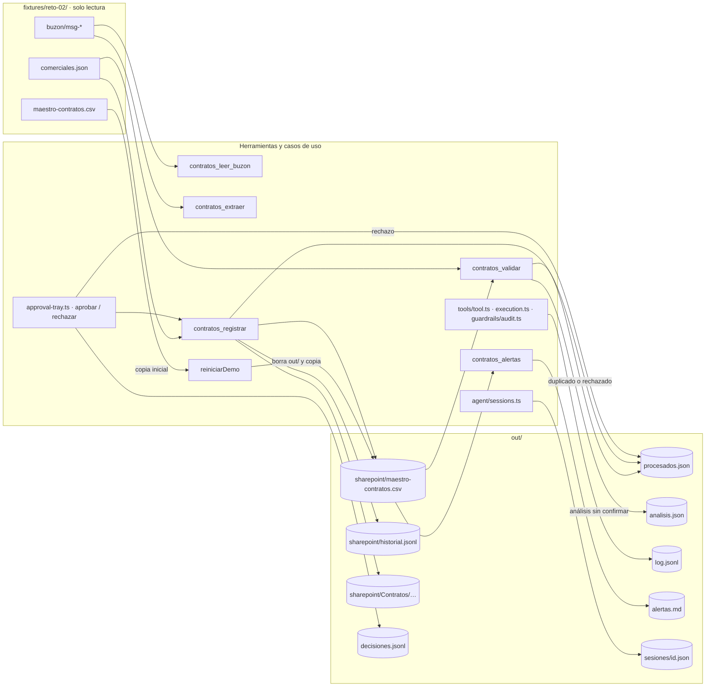
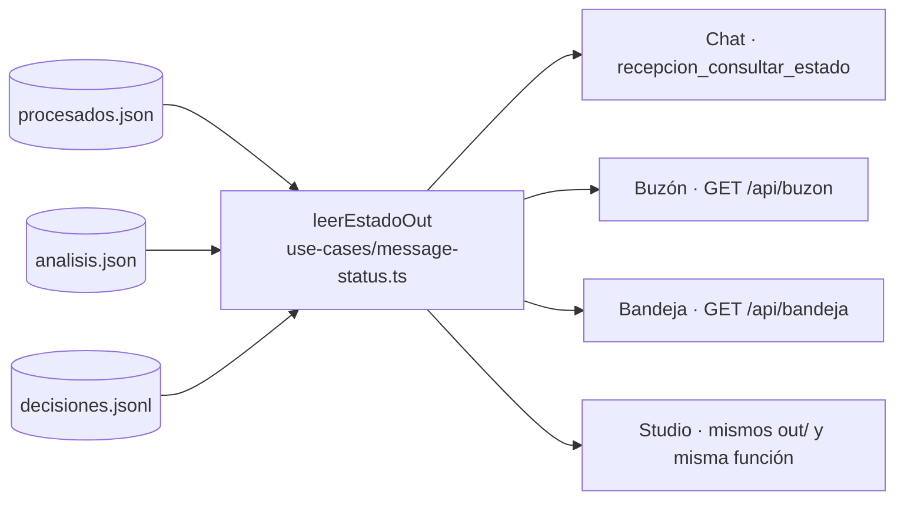

# Datos y almacenamiento

Sin base de datos (PRD §3.2): la entrada son carpetas en `fixtures/` y la salida son archivos en `out/`. SharePoint y Exchange se simulan con carpetas locales. Todas las rutas salen de `rutasDelProyecto(directorio)` en `api/src/infrastructure/paths.ts`.

## Entrada: `fixtures/reto-02/` (solo lectura)

```
fixtures/reto-02/
├── buzon/
│   ├── msg-001/  correo.json + contrato.txt
│   ├── msg-002/  correo.json + contrato.txt
│   ├── msg-003/  correo.json + otrosi.txt
│   ├── msg-004/  correo.json + contrato.txt
│   ├── msg-005/  correo.json + cotizacion.txt
│   └── msg-006/  correo.json + contrato.txt
├── maestro-contratos.csv   maestro congelado al 2026-05-30
└── comerciales.json        [{ email, nombre, region }]
```

`correo.json`:

```json
{
  "id": "msg-001",
  "de": "lgomez@periferia-ficticia.com",
  "para": "contratos@periferia-ficticia.com",
  "asunto": "Contrato firmado - Industrias Delta - Implementación CRM",
  "fecha": "2026-08-04T09:12:00-05:00",
  "cuerpo": "…",
  "adjuntos": ["contrato.txt"]
}
```

Lo leen `api/src/infrastructure/mailbox.ts` (correo y adjuntos, validados con zod) y `sales-reps.ts` (comerciales). Los ids de mensaje y nombres de adjunto pasan por `segmentoSeguro()`, que rechaza `../` y caracteres fuera de `[A-Za-z0-9._-]`.

### Columnas del maestro (PRD §7.2)

`id_contrato, cliente, nit_cliente, pais, objeto, valor, moneda, fecha_inicio, fecha_fin, requiere_poliza, tipo_poliza, estado_poliza, comercial, ruta_sharepoint, fecha_registro, fuente`

| Columna | Tipo |
|---|---|
| `pais` | `CO \| EC \| PE \| PA \| HN` |
| `moneda` | `COP \| USD \| PEN \| PAB \| HNL` |
| `valor` | número sin separadores; `0` si es por demanda |
| fechas | `YYYY-MM-DD` |
| `estado_poliza` | `vigente \| pendiente \| vencida \| no_aplica` |
| `fuente` | `buzon \| manual \| migracion` |

Esquema: `FilaMaestroSchema` en `api/src/core/domain/master.ts`. Al leer, cada fila se valida; una fila inválida da `maestro inválido en la línea N: …`.

## Salida: `out/` (ignorado por git)

```
out/
├── sharepoint/
│   ├── maestro-contratos.csv     maestro de trabajo (copia del fixture, RN6)
│   ├── historial.jsonl           cambios al maestro
│   └── Contratos/<año>/<cliente>/<id>.<ext>   documentos archivados
├── procesados.json               mensajes cerrados
├── analisis.json                 último análisis por mensaje
├── decisiones.jsonl              decisiones humanas
├── log.jsonl                     traza de herramientas (RN7)
├── alertas.md                    reporte de alertas
└── sesiones/<id>.json            sesiones del chat
```

| Archivo | Escribe | Forma |
|---|---|---|
| `sharepoint/maestro-contratos.csv` | `master-store.ts` (`guardarFila`) | CSV RFC 4180; inserta o reemplaza por `id_contrato` conservando el orden. |
| `sharepoint/historial.jsonl` | `logs.ts` (`registrarHistorial`) | `{ ts, id_contrato, accion: "insertado" \| "actualizado", cambios: { columna: { antes, despues } }, mensaje_id, ruta_archivo }` |
| `sharepoint/Contratos/…` | `logs.ts` (`archivarDocumento`) | Copia del adjunto. |
| `procesados.json` | `logs.ts` (`marcarProcesado`) | `{ "<mensaje_id>": { estado: "registrado" \| "actualizado" \| "duplicado" \| "rechazado", id_contrato, ts } }` |
| `analisis.json` | `analysis-store.ts` | `{ "<mensaje_id>": { ts, validacion } }`; solo análisis sin confirmación. |
| `decisiones.jsonl` | `decision-store.ts` | `{ ts, mensaje_id, decision: "aprobado" \| "rechazado", via: "bandeja" \| "chat" \| "studio", aprobador, correcciones, motivo, id_contrato, accion, cambios }` |
| `log.jsonl` | `tools/tool.ts`, `agent/execution.ts`, bandeja | `{ ts, herramienta, mensaje_id, ok, resumen }`; la bandeja usa `bandeja_aprobar` / `bandeja_rechazar`. |
| `alertas.md` | `use-cases/alerts.ts` | Markdown con tres tablas. |
| `sesiones/<id>.json` | `agent/sessions.ts` | Sesión completa (ver [Ciclo del agente](Agent-Loop.md#sesiones)). |

### Quién escribe y quién lee



`contratos_registrar` es la única que toca el maestro, y siempre después de revalidar. `contratos_validar` guarda en `analisis.json` todo análisis hecho sin `confirmado` y, si el mensaje es duplicado o rechazado, lo cierra en `procesados.json` sin tocar el maestro.

## Una sola verdad

El estado de cada mensaje se deriva **solo** de `procesados.json` + `analisis.json` + `decisiones.jsonl` (`leerEstadoOut` en `use-cases/message-status.ts`). Chat, buzón y bandeja leen lo mismo, así una decisión tomada en un canal se ve en todos sin sincronización extra.



## Garantías de escritura

- **Atómica**: `escribirTexto` escribe en un temporal y renombra; el maestro y los JSON nunca quedan a medio escribir.
- **JSONL tolerante**: `leerLineasJson` descarta una línea corrupta (p. ej. escritura cortada) sin perder las demás.
- **Acceso coordinado**: `AccesoOut` (`out-lock.ts`) deja que turnos y bandeja compartan `out/` y que el reinicio lo tome en exclusiva.
- **Un solo proceso**: no hay bloqueo entre procesos. En producción haría falta almacenamiento durable y transaccional (ver `SOLUCION.md` §11).

## Reinicio

`reiniciarDemo()` (`use-cases/reset-demo.ts`) borra todo `out/`, vuelve a copiar el maestro del fixture y devuelve cuántos mensajes quedan pendientes. Se expone como `POST /api/demo/reset` y como botón **Reiniciar demo**. `demo.ts` también limpia `out/` al empezar.
