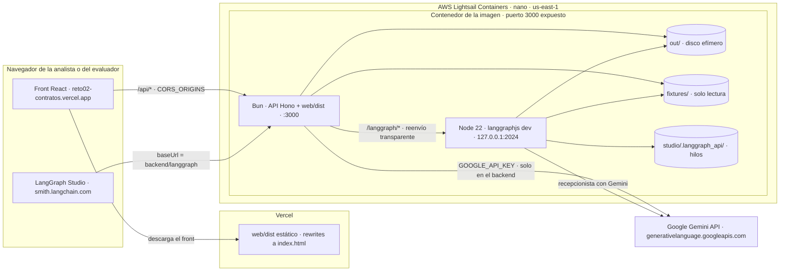
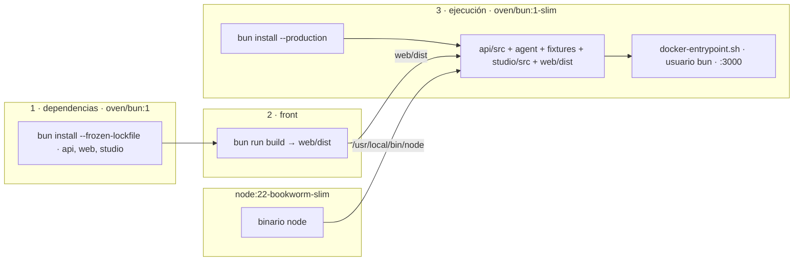
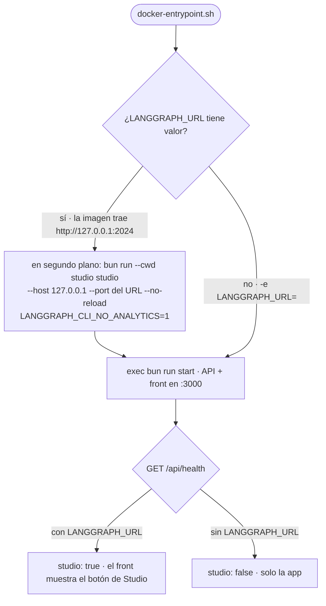
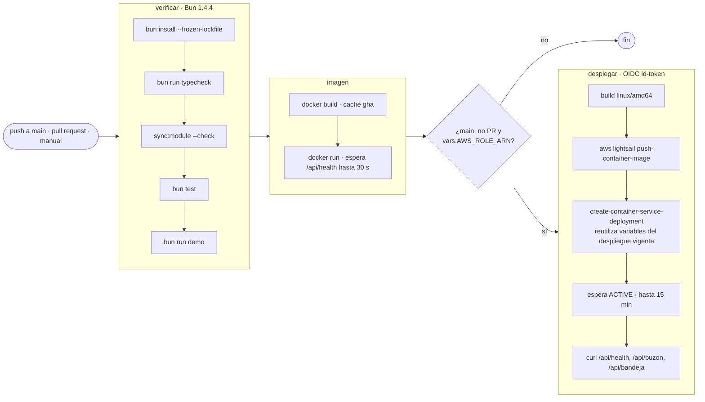

# Despliegue

## Topología en producción



El front y Studio son solo clientes: toda la lógica, la clave del modelo y el estado viven en el contenedor. La API y el servidor de LangGraph comparten `out/`, así que un registro hecho desde Studio aparece en la web y al revés.

## Imagen única (API + front + LangGraph Studio)



`Dockerfile` en tres etapas:

1. **dependencias**: `bun install --frozen-lockfile` de los workspaces `api/`, `web/` y `studio/`.
2. **front**: copia `web/` y `api/src/http/types.ts` (tipos compartidos) y ejecuta `bun run build`.
3. **ejecución** (`oven/bun:1-slim` + el binario de Node 22 de `node:22-bookworm-slim`): dependencias de producción, `api/src/`, `agent/`, `fixtures/`, `studio/src` con su `langgraph.json` y `web/dist`; usuario `bun`; arranca con `docker-entrypoint.sh` en el puerto 3000.



`docker-entrypoint.sh` hace `exec bun run start` (API + front). Si `LANGGRAPH_URL` tiene valor (la imagen trae `http://127.0.0.1:2024`), antes levanta en segundo plano `langgraphjs dev` de `studio/` bajo Node, escuchando solo en `127.0.0.1` y en el puerto de esa URL, sin recarga ni telemetría. La API lo publica en `/langgraph/*` (`api/src/http/langgraph-proxy.ts`), porque el contenedor expone un solo puerto, y `/api/health` responde `studio: true`, que es lo que muestra el botón **Abrir en LangGraph Studio** del front. Si el servidor de LangGraph se cae, la app sigue y `/langgraph` responde `502 langgraph_no_disponible`. Con `-e LANGGRAPH_URL=` solo arranca la API.

El contexto lo filtra `.dockerignore` (sin `node_modules`, `.env`, `.git`, `docs`, `out`, `api/tests`, `studio/tests`, `studio/.langgraph_api`).

```bash
docker build -t agente-contratos .
docker run -p 3000:3000 -e GOOGLE_API_KEY=... agente-contratos
# o
docker compose up --build        # lee .env si existe
```

## Producción actual: Vercel + AWS Lightsail

| Pieza | Servicio | Configuración |
|---|---|---|
| Front (`web/`) | Vercel, proyecto `reto02-contratos` | `web/vercel.json`; variable de build `VITE_API_URL` = URL del backend. |
| Backend (imagen) | AWS Lightsail Containers `reto02-contratos` (nano, 1 nodo, `us-east-1`) | Puerto 3000, health check `/api/health`; `LLM_PROVIDER=gemini`, `GOOGLE_API_KEY`, `GEMINI_MODEL`, `CORS_ORIGINS=https://reto02-contratos.vercel.app`. |

Studio queda en `https://<servicio>.cs.amazonlightsail.com/langgraph`; el botón del front abre `https://smith.langchain.com/studio/?baseUrl=<backend>/langgraph`. Studio llama a ese `baseUrl` desde el navegador; el servidor de LangGraph acepta cualquier origen, así que `CORS_ORIGINS` no hace falta para Studio. Memoria medida: unos 250–310 MB con los dos procesos, dentro de los 512 MB del plan nano; si se queda corto, usa `micro`.

Por qué Lightsail y no Lambda: un proceso siempre encendido conserva sesiones y `out/` entre «procesa el buzón» y «confirmo…» (`SOLUCION.md` §7).

### Integración y despliegue continuo

`.github/workflows/backend.yml` corre en cada push a `main` y en cada pull request que toque `api/`, `agent/`, `modulo/`, `fixtures/`, `web/`, `demo.ts`, el `Dockerfile` o el propio workflow. Siempre con `LLM_PROVIDER=offline`: la CI nunca llama a Gemini ni necesita secretos del modelo.



El despliegue asume un rol de AWS por OIDC (sin claves guardadas en GitHub) y copia las variables del despliegue vigente, así `GOOGLE_API_KEY` solo vive en Lightsail. El front no lo despliega la CI: se publica con `vercel deploy` (abajo).

### Backend

```bash
docker buildx build --platform linux/amd64 -t reto02-contratos:latest --load .
aws lightsail create-container-service --service-name reto02-contratos --power nano --scale 1   # primera vez
aws lightsail push-container-image --service-name reto02-contratos --label app --image reto02-contratos:latest
# create-container-service-deployment con la imagen ":reto02-contratos.app.<n>", variables y health check
```

Con `aws login`, exporta las credenciales para `lightsailctl`: `eval "$(aws configure export-credentials --format env)"`.

### Front

```bash
cd web && vercel deploy --prod --build-env VITE_API_URL=https://<servicio>.cs.amazonlightsail.com
```

### Apagar

```bash
aws lightsail delete-container-service --service-name reto02-contratos
```

## Alternativa: Render

`render.yaml` despliega la misma imagen (API + front) como un servicio web Docker con health check `/api/health`. Solo hay que cargar `GOOGLE_API_KEY` como secreto en el panel.

## Seguridad y operación

- La clave del LLM solo existe como variable de entorno del contenedor: no está en el repositorio, la imagen ni el front.
- El disco del contenedor es efímero: `out/` y las sesiones se pierden al redesplegar. Mientras vive, **Reiniciar demo** deja el buzón limpio.
- El link es público y el estado es compartido: los topes de iteraciones y tokens protegen la clave. En producción: autenticación, aprobador tomado de la identidad y reinicio deshabilitado (`SOLUCION.md` §11).
- `/langgraph` también es público y sin autenticación. El grafo `recepcionista` aplica los mismos topes que la app (iteraciones por turno, tokens por hilo y por proceso), pero cada proceso lleva su propia cuenta: el consumo máximo del contenedor es el doble de `MAX_TOKENS_PROCESO`. En Studio se puede editar el estado de un hilo (`tokens`, `pendientes`), así que el tope que no se puede evadir es el del proceso; los hilos viven en `studio/.langgraph_api/` y se pierden al redesplegar.
- `idleTimeout` de Bun en 255 s: un turno con varias llamadas al modelo puede tardar más que los 10 s por defecto.
