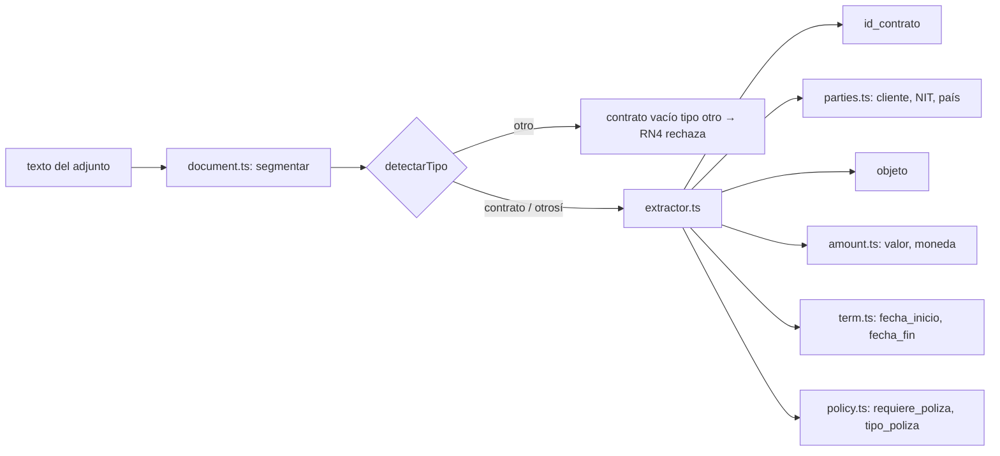

# Extracción

Código: `api/src/core/extraction/`. Determinista (regex y heurísticas sobre el texto del adjunto), sin modelo, sin E/S. Punto de entrada: `extraerContrato(texto): Resultado<Contrato>`.

## Por qué determinista

El riesgo principal del PRD es que el modelo "redondee" un valor o invente una fecha. Con extracción determinista cada valor trae su **evidencia literal** y una **confianza reproducible**, y la demo y los tests corren sin clave. Lo que la extracción no reconoce con seguridad baja de 0.8 y pasa por revisión humana.

## Pipeline



| Paso | Archivo | Qué hace |
|---|---|---|
| Segmentación | `document.ts` | Separa encabezado, preámbulo, cláusulas (`PRIMERA — OBJETO`, …) y firmas. Detecta el tipo: contrato, otrosí u otro. |
| Id | `extractor.ts` | `No. CT-2026-015` (0.95) o un id suelto con formato de contrato (0.8). En un otrosí toma el número del contrato referenciado. |
| Partes | `parties.ts` | Cliente = parte rotulada «EL CONTRATANTE» distinta de la empresa propia (NIT 900123456). NIT sin puntos ni DV (`890.900.111-4` → `890900111`). País por tipo de identificador (NIT→CO, RTN→HN, RUC 13→EC, RUC 11→PE) cruzado con el domicilio. |
| Objeto | `extractor.ts` | Texto literal de la cláusula OBJETO; si supera 200 caracteres se trunca en palabra (0.85). |
| Valor y moneda | `amount.ts` | Formatos `265.000.000` y `120,000.00`; código ISO explícito. `$` sin código → COP (0.6). "Por demanda" → `valor = 0`, `valor_indeterminado = true` (0.5). Moneda fuera de COP/USD/PEN/PAB/HNL → error legible. |
| Plazo | `term.ts`, `prose-dates.ts` | Fechas en prosa con la cifra entre paréntesis (`primero (1) de agosto de 2026`). Plazo en meses → fin inclusivo (`inicio + N meses − 1 día`). Rango y meses inconsistentes → `fecha_fin` 0.6. Firma solo con mes → inicio día 1 y fin último día del mes N, ambos 0.5. |
| Póliza | `policy.ts` | Cláusula de garantías/pólizas; tipos normalizados separados por `;`. Garantía condicional por orden de servicio → `requiere_poliza = false` (0.8) con nota. |
| Otrosí | `extractor.ts` | `numero_otrosi` y `campos_modificados` según la cláusula que modifica; el resto se hereda del maestro. |

## Niveles de confianza

No son probabilidades: son niveles fijos según la fuerza de la evidencia.

| Confianza | Significado |
|---|---|
| 0.95 | Explícito y consistente. |
| 0.85–0.9 | Derivado (fin por meses, objeto truncado). |
| 0.8 | Tomado de otra cláusula. |
| 0.5–0.6 | Ambiguo o contradictorio. |
| 0 (`valor: null`) | No aparece en el documento. Nunca se inventa. |

Umbral **0.8** (`UMBRAL_CONFIANZA` en `api/src/core/domain/parameters.ts`): por debajo, el campo va a `requiere_revision`.

## Forma de la salida

```json
{
  "tipo_documento": "contrato",
  "numero_otrosi": null,
  "campos_modificados": [],
  "valor_indeterminado": true,
  "valor": { "valor": 0, "confianza": 0.5, "evidencia": "…por demanda…" },
  "fecha_fin": { "valor": "2027-08-31", "confianza": 0.5, "evidencia": "…doce (12) meses…" },
  "notas": ["Valor por demanda: …"]
}
```

Esquema completo: `ContratoSchema` en `api/src/core/domain/contract.ts`.

## Errores

- Texto vacío → `fallo("el texto del contrato está vacío")`.
- Datos imposibles (fecha inválida, mes desconocido, moneda desconocida) → `ErrorExtraccion`, convertido en `{ ok: false, error }` legible.
- Cualquier otra excepción la captura la capa de herramientas.

## Dónde entra el modelo y dónde no

- **Sí**: orquesta las herramientas, presenta resultados, pregunta y traduce «confirmo …» a una llamada con `confirmado: true` y los valores corregidos.
- **No**: no extrae, no clasifica, no calcula alertas, no escribe archivos. Si propone un valor distinto al del documento, `validar`/`registrar` lo detectan al reextraer y le asignan confianza 0 (ver [Reglas de negocio → Campos efectivos](Business-Rules.md#campos-efectivos)).

## Mejorar la extracción

Edita el archivo del campo, conserva la evidencia literal y un nivel de confianza fijo, y agrega un caso en `api/tests/unit/extraction.test.ts` (hay utilidades para modificar la prosa de un fixture: `contratoModificado`).
