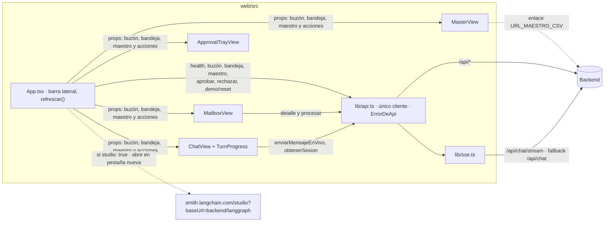

# Front

React 19 + Vite 6 + TypeScript, sin librerías de UI ni de estado. Código en `web/src/`. Es uno de los tres workspaces de Bun (`"workspaces": ["api", "web", "studio"]` en el `package.json` raíz).

## Pestañas

| Pestaña | Vista | Qué muestra |
|---|---|---|
| **Buzón** | `views/MailboxView.tsx` | Los 6 correos con su estado. **Analizar** procesa uno; **Analizar todo en orden** recorre los pendientes con progreso y **Detener**. El detalle trae la línea de tiempo de 7 pasos, el correo y el adjunto al lado de lo extraído (confianza y evidencia por campo), la clasificación y la auditoría. |
| **Bandeja de aprobación** | `views/ApprovalTrayView.tsx` | Lo que espera decisión humana (contador en la pestaña): campos editables, **Confirmar datos y registrar** o **Rechazar** con motivo. A la derecha, las decisiones ya tomadas (bandeja, chat o Studio). |
| **Maestro CSV** | `views/MasterView.tsx` | El maestro de trabajo con las filas creadas o modificadas por una aprobación resaltadas, y **Descargar CSV**. |
| **Chat** | `views/ChatView.tsx` | Turnos, cada llamada a herramienta (nombre, argumentos, resultado), burbuja resaltada y banner **Confirmo** cuando el agente pide confirmación. Mientras corre el turno muestra el progreso en vivo (`components/TurnProgress.tsx`): qué hace el modelo, la herramienta en curso y cada paso del motor apenas termina, vía `POST /api/chat/stream` (`lib/api.ts` `enviarMensajeEnVivo`, `lib/sse.ts`, `lib/turn-progress.ts`). Abre por defecto. |

`App.tsx` arma la barra lateral (pestañas, contadores, proveedor activo, **Abrir en LangGraph Studio** si `/api/health` trae `studio: true`, **Aprobador**, **Reiniciar demo**) y vuelve a pedir buzón, bandeja y maestro (`refrescar`) tras cada acción o turno del chat.

## Componentes

| Componente | Archivo | Uso |
|---|---|---|
| `ProposalCard` | `components/ProposalCard.tsx` | Tarjeta de un pendiente: campos en revisión editables, aprobar con correcciones o rechazar. Se usa en la bandeja y en el detalle del buzón. |
| `ResolutionCard` | `components/ProposalCard.tsx` | Decisión ya tomada: quién, cuándo, canal, qué corrigió. |
| `ToolCall`, `ToolCallList` | `components/ToolCallList.tsx` | Llamadas a herramientas de un turno del chat. |
| `MarkdownText` | `components/MarkdownText.tsx` | Render propio de un subconjunto de Markdown (tablas, títulos, listas, negrita, código). React escapa todo: no hay HTML crudo desde el texto del modelo. |
| `StatusChip` | `views/MailboxView.tsx` | Chip de estado de un mensaje. |

## Cliente de API

`lib/api.ts` es el **único** punto que habla con el backend:

- `BASE_API` sale de `VITE_API_URL` (vacío = mismo origen).
- Reexporta los tipos de `api/src/http/types.ts`: backend y front comparten el mismo archivo y no divergen.
- Cualquier fallo (red, error tipado, respuesta inesperada) se convierte en `ErrorDeApi` con mensaje en español y el `codigo` del backend.

`lib/format.ts` tiene etiquetas de campos, clasificaciones y estados, formato de valores, fechas y porcentajes, y `mensajeDeFalla`.

## Estado local

| Clave en `localStorage` | Contenido |
|---|---|
| `contratos.sessionId` | Sesión de chat actual (se crea una nueva al reiniciar la demo o con "nueva sesión"). |
| `contratos.aprobador` | Nombre del aprobador que queda en las decisiones. |

## Desarrollo y build

| Comando | Efecto |
|---|---|
| `bun run dev` (raíz) | Vite en `:5173` con proxy de `/api` a `127.0.0.1:${PORT}`. |
| `bun run build` (raíz) | `vite build` → `web/dist/`, que el backend sirve en producción. |
| `bun run typecheck` (raíz) | Incluye `tsc --noEmit -p web`. |

En Vercel (`web/vercel.json`): framework Vite, salida `dist`, rewrites a `index.html`, variable de build `VITE_API_URL` con la URL del backend.

## Agregar una vista

Ver [Contribuir → Nueva vista del front](Contributing.md#nueva-vista-del-front).
