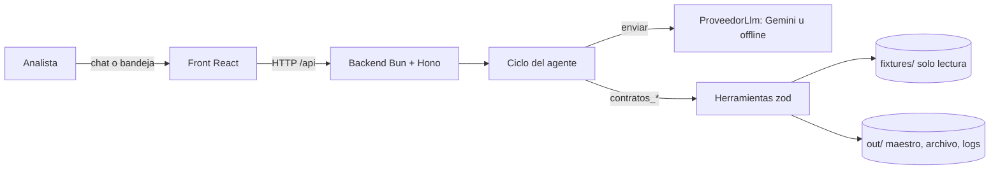

# Wiki · Agente "Registro de Contratos Vigentes"

Documentación técnica del repositorio: cómo está construido, por qué y cómo cambiarlo sin romper nada. El enunciado está en [`docs/PRD.md`](../PRD.md), las decisiones de la entrega en [`SOLUCION.md`](../../SOLUCION.md) y las reglas para agentes de código en [`AGENTS.md`](../../AGENTS.md).

## En 30 segundos

El maestro de contratos de la empresa está congelado desde el 2026-05-30. Este agente es el **punto único de recepción**: lee un buzón de correos, extrae los datos de cada contrato con una confianza por campo, lo clasifica contra el maestro, registra lo limpio, **pide confirmación humana** para lo dudoso y genera alertas de vencimientos y pólizas.

## Páginas

| Página | Para qué |
|---|---|
| [Primeros pasos](Getting-Started.md) | Instalar, levantar en local, variables de entorno, flujo de la demo. |
| [Arquitectura](Architecture.md) | Capas, dependencias, composición y concurrencia. |
| [Estructura del proyecto](Project-Structure.md) | Qué hay en cada carpeta y archivo. |
| [Ciclo del agente](Agent-Loop.md) | Turno, topes, confirmación humana (CA1–CA5) y sesiones. |
| [Herramientas](Tools.md) | Contrato `contratos_*`, validación, log y cómo llamarlas. |
| [Extracción](Extraction.md) | Extractor determinista y niveles de confianza. |
| [Reglas de negocio](Business-Rules.md) | RN1–RN7, clasificación, campos efectivos y estados de un mensaje. |
| [Datos y almacenamiento](Data-and-Storage.md) | Fixtures de entrada y cada archivo de `out/`. |
| [API HTTP](API.md) | Endpoints, cuerpos, errores tipados. |
| [Front](Frontend.md) | Pestañas, componentes y cliente de API. |
| [Proveedores LLM](LLM-Providers.md) | Interfaz `ProveedorLlm`, Gemini, offline, cómo agregar otro. |
| [Módulo reutilizable](Agent-Module.md) | `modulo/` (bonus PRD 9.4) y su sincronía. |
| [Pruebas](Testing.md) | Organización, utilidades y CI. |
| [Despliegue](Deployment.md) | Docker, Vercel + AWS Lightsail, Render. |
| [Contribuir](Contributing.md) | Convenciones, recetas paso a paso y checklist. |
| [Glosario](Glossary.md) | Términos del dominio y equivalencias español ↔ inglés. |

## Enlaces rápidos

- Demo pública: <https://reto02-contratos.vercel.app>
- Comandos: `bun install && bun run dev` · `bun test` · `bun run typecheck` · `bun run demo`
