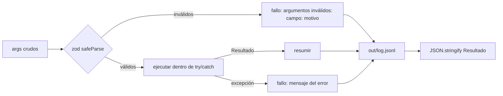

# Herramientas

Hay dos conjuntos, con el mismo envoltorio (`api/src/tools/tool.ts`):

| Archivo | Prefijo | Quién las llama |
|---|---|---|
| `api/src/tools/recepcion.ts` | `recepcion_*` | **El modelo** (la recepcionista del chat). Son las únicas que ve. |
| `api/src/tools/contratos.ts` | `contratos_*` | **El motor determinista** (`application/workflows/`), `demo.ts`, los tests y `modulo/`. Es el contrato mínimo del PRD §6.2. |

Juntas son la **única fuente de valores** que el agente puede afirmar y la única vía de escritura. La arquitectura de las dos capas está en [Arquitectura → Dos grafos](Architecture.md#dos-grafos-la-recepcionista-y-el-motor).

## Las cinco herramientas de la recepcionista

| Nombre | Entrada | Salida (`data`) | Motor |
|---|---|---|---|
| `recepcion_consultar_estado` | `{}` | `{ contadores, mensajes[], errores[] }` como `GET /api/buzon` | no |
| `recepcion_consultar_maestro` | `{ consulta? }` | `{ total, filas[], truncado }` (máx. 25 filas; busca en id, cliente y NIT sin tildes) | no |
| `recepcion_explicar_validacion` | `{ mensaje_id }` | `{ mensaje, extraccion, validacion, decision, fila, linea_tiempo }` | no |
| `recepcion_procesar_buzon` | `{ hoy, mensaje_ids? }` | `{ mensajes[], omitidos[], en_revision[], alertas }`; cada mensaje con `desenlace`, `recorrido`, `revision[]` (campo, valor, confianza, evidencia, motivo) y `accion` | ingestar → grafo por mensaje → alertas |
| `recepcion_responder_revision` | `{ mensaje_id, decision, correcciones?, motivo?, hoy? }` | `{ mensaje_id, decision, estado, id_contrato, accion, correcciones, cambios, alertas }` | reanuda la pausa |

- `mensaje_ids` omitido procesa todo lo pendiente; `[]` solo regenera alertas; un id no pendiente sale en `omitidos`.
- `responder_revision` con `decision: "rechazar"` exige `motivo`. El aprobador queda como `chat <sessionId>` y la decisión en `out/decisiones.jsonl` con `via: "chat"`.
- El contrato completo **no** vuelve al modelo: solo lo que necesita para responder.
- Las llamadas `contratos_*` que hace el motor por debajo van a `ctx.traza` y el chat las muestra como `pasos` de la llamada.

## Contrato (PRD §6.2)

Cada herramienta exportada, de los dos conjuntos, es un objeto con tres miembros:

| Miembro | Regla |
|---|---|
| `description` | Una frase: es lo único que el modelo lee para decidir cuándo llamarla. |
| `args` | Objeto de esquemas zod con `.describe()` en cada campo. |
| `execute(args, ctx)` | Devuelve **string** JSON con `{ ok: true, data }` o `{ ok: false, error }`. **Nunca lanza.** |

El nombre de cada herramienta es `<archivo>_<export>`: `contratos_leer_buzon`, `recepcion_procesar_buzon`, etc.

`ctx` (`ContextoHerramienta`):

| Campo | Uso |
|---|---|
| `directory` | Raíz del proyecto. Todas las rutas se resuelven desde aquí (`rutasDelProyecto`). |
| `sessionId` | Sesión que llama (`demo`, `test`, `bandeja` o la del chat). |
| `hoy?` | Fecha de registro fija para que demo y tests sean deterministas. |
| `traza?` | Si existe, el motor anota aquí cada llamada `contratos_*` que hace (para mostrarlas anidadas en el chat). |

## Las cinco herramientas del motor

| Nombre | Entrada | Salida (`data`) | Escribe |
|---|---|---|---|
| `contratos_leer_buzon` | `{}` | `{ mensajes[], errores[] }`: id, remitente, asunto, fecha, adjuntos, `tiene_contrato` | `log.jsonl` |
| `contratos_extraer` | `{ mensaje_id }` | `Contrato` con `{ valor, confianza, evidencia }` por campo y `notas[]` | `log.jsonl` |
| `contratos_validar` | `{ mensaje_id, contrato }` | `{ clasificacion, motivo, id_contrato_existente, requiere_revision[], revisiones[], diferencias[], avisos[], comercial, procesado }` | `analisis.json`; `procesados.json` si es duplicado o rechazado |
| `contratos_registrar` | `{ mensaje_id, contrato, confirmado? }` | `{ id_contrato, accion, ruta_archivo, cambios, avisos }` o error `requiere revisión: …` | maestro CSV, `Contratos/…`, `historial.jsonl`, `procesados.json` |
| `contratos_alertas` | `{ hoy: "YYYY-MM-DD" }` | `{ ruta, vencen[], polizas_pendientes[], registrados_desde_corte[] }` | `alertas.md` |

Todas escriben una línea en `out/log.jsonl` (RN7). `contratos_leer_pdf` (P1 opcional) no está implementada: los fixtures traen texto.

## Qué hace `definirHerramienta`



1. Valida los argumentos con zod. Si fallan, devuelve `argumentos inválidos: <ruta>: <motivo>`; el ciclo se lo pasa al modelo para que reintente.
2. Ejecuta la lógica (un caso de uso) dentro de `try/catch`.
3. Calcula un **resumen** legible (p. ej. `nuevo; revisión: valor, fecha_fin`), que va al log y al chat.
4. Escribe la línea de log; si el log falla, lo reporta por stderr sin tumbar la herramienta.

El resumen se guarda fuera del objeto (en un `WeakMap`) para respetar los tres miembros del contrato.

## Cómo llamarlas desde código

```ts
import { ejecutarHerramienta } from "./src/tools/contratos.ts";

const ctx = { directory: process.cwd(), sessionId: "script", hoy: "2026-09-03" };
const json = await ejecutarHerramienta("contratos_extraer", { mensaje_id: "msg-001" }, ctx);
const resultado = JSON.parse(json); // { ok: true, data: Contrato } | { ok: false, error }
```

Con tipo: `llamarHerramienta<T>(nombre, args, ctx)` en `api/src/application/workflows/tool-call.ts` (además anota en `ctx.traza`). Cada archivo arma su conjunto cerrado con `registroDeHerramientas(prefijo, herramientas)`: `ejecutarHerramienta` acepta el nombre con o sin prefijo (`extraer` o `contratos_extraer`) y un nombre fuera del conjunto devuelve `{ ok: false, error: "herramienta desconocida: …" }` con la lista de disponibles.

## Quién las usa

| Consumidor | Cómo |
|---|---|
| Ciclo del agente | `api/src/agent/execution.ts` → `ejecutarHerramienta` de `recepcion.ts` con los argumentos del modelo. |
| Motor determinista | `contract-graph.ts`, `process-mailbox.ts` y `approval-tray.ts` → `llamarHerramienta` sobre `contratos_*`. |
| `demo.ts` y tests | `procesarBuzon` / `llamarHerramienta`. |
| Bandeja y botón Analizar | `api/src/application/workflows/approval-tray.ts` (misma reanudación que el chat). |
| Otras plataformas | `modulo/tools/recepcion.ts` y `modulo/tools/contratos.ts` las reexportan. |

## Agregar una herramienta

Ver [Contribuir → Nueva herramienta](Contributing.md#nueva-herramienta).
