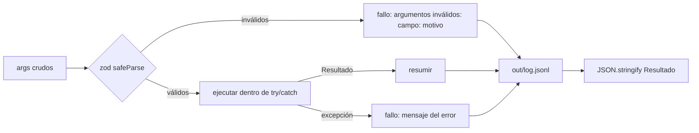

# Herramientas

Código: `api/src/tools/contratos.ts` (las herramientas) y `api/src/tools/tool.ts` (envoltorio común). Son la **única fuente de valores** que el agente puede afirmar y la única vía de escritura.

## Contrato (PRD §6.2)

Cada herramienta exportada es un objeto con tres miembros:

| Miembro | Regla |
|---|---|
| `description` | Una frase: es lo único que el modelo lee para decidir cuándo llamarla. |
| `args` | Objeto de esquemas zod con `.describe()` en cada campo. |
| `execute(args, ctx)` | Devuelve **string** JSON con `{ ok: true, data }` o `{ ok: false, error }`. **Nunca lanza.** |

El nombre que ve el modelo es `<archivo>_<export>`: `contratos_leer_buzon`, `contratos_extraer`, etc.

`ctx` (`ContextoHerramienta`):

| Campo | Uso |
|---|---|
| `directory` | Raíz del proyecto. Todas las rutas se resuelven desde aquí (`rutasDelProyecto`). |
| `sessionId` | Sesión que llama (`demo`, `test`, `bandeja` o la del chat). |
| `hoy?` | Fecha de registro fija para que demo y tests sean deterministas. |

## Las cinco herramientas

| Nombre | Entrada | Salida (`data`) | Escribe |
|---|---|---|---|
| `contratos_leer_buzon` | `{}` | `{ mensajes[], errores[] }`: id, remitente, asunto, fecha, adjuntos, `tiene_contrato` | `log.jsonl` |
| `contratos_extraer` | `{ mensaje_id }` | `Contrato` con `{ valor, confianza, evidencia }` por campo y `notas[]` | `log.jsonl` |
| `contratos_validar` | `{ mensaje_id, contrato }` | `{ clasificacion, motivo, id_contrato_existente, requiere_revision[], revisiones[], diferencias[], avisos[], comercial, procesado }` | `analisis.json`; `procesados.json` si es duplicado o rechazado |
| `contratos_registrar` | `{ mensaje_id, contrato, confirmado? }` | `{ id_contrato, accion, ruta_archivo, cambios, avisos }` o error `requiere revisión: …` | maestro CSV, `Contratos/…`, `historial.jsonl`, `procesados.json` |
| `contratos_alertas` | `{ hoy: "YYYY-MM-DD" }` | `{ ruta, vencen[], polizas_pendientes[], registrados_desde_corte[] }` | `alertas.md` |

Todas escriben una línea en `out/log.jsonl` (RN7). `contratos_leer_pdf` (P1 opcional) no está implementada: los fixtures traen texto.

## Qué hace `definirHerramienta`



1. Valida los argumentos con zod. Si fallan, devuelve `argumentos inválidos: <ruta>: <motivo>`; el ciclo se lo pasa al modelo para que reintente.
2. Ejecuta la lógica (un caso de uso) dentro de `try/catch`.
3. Calcula un **resumen** legible (p. ej. `nuevo; revisión: valor, fecha_fin`), que va al log y al chat.
4. Escribe la línea de log; si el log falla, lo reporta por stderr sin tumbar la herramienta.

El resumen se guarda fuera del objeto (en un `WeakMap`) para respetar los tres miembros del contrato.

## Cómo llamarlas desde código

```ts
import { ejecutarHerramienta } from "./src/tools/contratos.ts";

const ctx = { directory: process.cwd(), sessionId: "script", hoy: "2026-09-03" };
const json = await ejecutarHerramienta("contratos_extraer", { mensaje_id: "msg-001" }, ctx);
const resultado = JSON.parse(json); // { ok: true, data: Contrato } | { ok: false, error }
```

Con tipo: `llamarHerramienta<T>(nombre, args, ctx)` en `api/src/application/workflows/process-mailbox.ts`. `ejecutarHerramienta` acepta el nombre con o sin prefijo (`extraer` o `contratos_extraer`); un nombre desconocido devuelve `{ ok: false, error: "herramienta desconocida: …" }` con la lista de disponibles.

## Quién las usa

| Consumidor | Cómo |
|---|---|
| Ciclo del agente | `api/src/agent/execution.ts` → `ejecutarHerramienta` con los argumentos del modelo. |
| `demo.ts` y tests | `procesarBuzon` / `llamarHerramienta`. |
| Bandeja y botón Analizar | `api/src/application/workflows/approval-tray.ts`. |
| Otras plataformas | `modulo/tools/contratos.ts` las reexporta. |

## Agregar una herramienta

Ver [Contribuir → Nueva herramienta](Contributing.md#nueva-herramienta).
